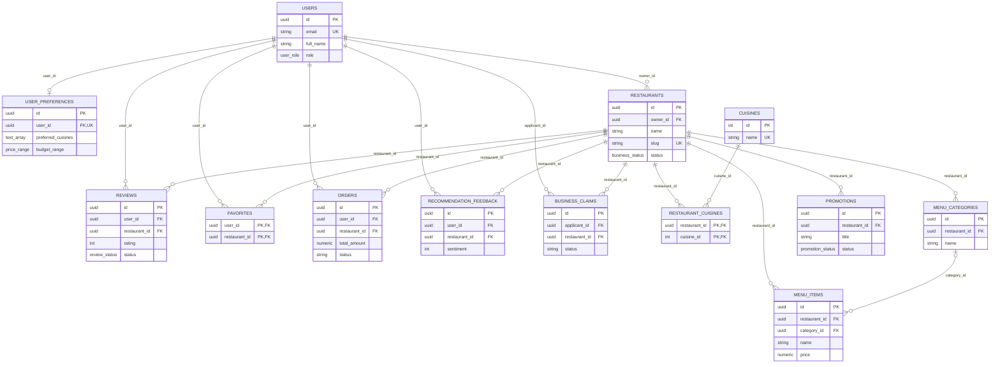

# Cordova Eats: simple entity relationship diagram

This is a compact view of the main application data. It follows the declared
foreign keys in PostgreSQL migrations `001`–`016`. The [complete ERD](ERD_FULL.md)
shows all 32 application tables and 46 foreign-key relationships.

`||` means one required parent, `o|` means an optional related row, and `o{`
means zero or more rows. `PK` is a primary key, `FK` is a declared foreign key,
and `UK` is unique. Each relationship label names the child table's FK.

The join tables `restaurant_cuisines` and `favorites` represent many-to-many
relationships. A user can write only one review per restaurant, enforced by
`UNIQUE (restaurant_id, user_id)`. A menu item can have no category because
`menu_items.category_id` is nullable. This overview omits supporting tables
for authentication, photos, operating hours, subscriptions, analytics,
notifications, moderation, and claim documents; they appear in the complete
diagram.
