# Cordova Eats: complete entity relationship diagram

For a compact view of the main application entities, see the
[simple ERD](ERD.md).

This diagram reflects the PostgreSQL application schema produced by
`database/migrations/001_initial_schema.sql` through
`016_reconcile_review_statistics.sql`, in the order used by
`backend/src/scripts/migrate.js`. It includes all 32 application tables in
that migration path. `PK` marks a primary key, `FK` a declared foreign key,
and `UK` a unique key. Each relationship label names the child table's FK.
`||` means exactly one parent; `o|` means an optional parent; `o{` means zero
or more child rows. A unique child FK is shown as `o|` on the child side.

```mermaid
erDiagram
    USERS ||--o{ REFRESH_TOKENS : user_id
    USERS ||--o{ EMAIL_VERIFICATION_TOKENS : user_id
    USERS ||--o{ PASSWORD_RESET_TOKENS : user_id
    USERS ||--o| USER_PREFERENCES : user_id
    USERS ||--o{ RESTAURANTS : owner_id
    USERS o|--o{ RESTAURANTS : verified_by
    USERS ||--o{ REVIEWS : user_id
    USERS o|--o{ REVIEWS : moderated_by
    USERS ||--o{ REVIEW_LIKES : user_id
    USERS ||--o{ REVIEW_REPORTS : reporter_id
    USERS o|--o{ REVIEW_MODERATION_EVENTS : moderator_id
    USERS ||--o{ FAVORITES : user_id
    USERS o|--o{ SUBSCRIPTION_TRANSACTIONS : verified_by
    USERS ||--o{ ORDERS : user_id
    USERS o|--o{ RECOMMENDATION_LOGS : user_id
    USERS ||--o{ RECOMMENDATION_FEEDBACK : user_id
    USERS o|--o{ RECOMMENDATION_MODEL_VERSIONS : trained_by
    USERS o|--o{ RESTAURANT_VIEW_LOGS : user_id
    USERS o|--o{ RECOMMENDATION_WEIGHTS : updated_by
    USERS ||--o{ NOTIFICATIONS : user_id
    USERS o|--o{ AUDIT_LOGS : actor_id
    USERS ||--o{ BUSINESS_CLAIMS : applicant_id
    USERS o|--o{ BUSINESS_CLAIMS : reviewed_by
    USERS o|--o{ BUSINESS_CLAIM_EVENTS : actor_id

    RESTAURANTS ||--o{ RESTAURANT_CUISINES : restaurant_id
    CUISINES ||--o{ RESTAURANT_CUISINES : cuisine_id
    RESTAURANTS ||--o{ RESTAURANT_DIETARY_OPTIONS : restaurant_id
    RESTAURANTS ||--o{ RESTAURANT_IMAGES : restaurant_id
    RESTAURANTS ||--o{ OPERATING_HOURS : restaurant_id
    RESTAURANTS ||--o{ MENU_CATEGORIES : restaurant_id
    RESTAURANTS ||--o{ MENU_ITEMS : restaurant_id
    MENU_CATEGORIES o|--o{ MENU_ITEMS : category_id
    RESTAURANTS ||--o{ REVIEWS : restaurant_id
    REVIEWS ||--o{ REVIEW_LIKES : review_id
    REVIEWS ||--o{ REVIEW_REPORTS : review_id
    REVIEWS ||--o{ REVIEW_MODERATION_EVENTS : review_id
    RESTAURANTS ||--o{ FAVORITES : restaurant_id
    RESTAURANTS ||--o{ PROMOTIONS : restaurant_id
    RESTAURANTS ||--o{ SUBSCRIPTION_TRANSACTIONS : restaurant_id
    RESTAURANTS ||--o{ ORDERS : restaurant_id
    RESTAURANTS o|--o{ RECOMMENDATION_LOGS : top_result_id
    RESTAURANTS ||--o{ RECOMMENDATION_FEEDBACK : restaurant_id
    RESTAURANTS ||--o{ RESTAURANT_VIEW_LOGS : restaurant_id
    RESTAURANTS ||--o{ BUSINESS_CLAIMS : restaurant_id
    BUSINESS_CLAIMS ||--o{ BUSINESS_CLAIM_DOCUMENTS : claim_id
    BUSINESS_CLAIMS ||--o{ BUSINESS_CLAIM_EVENTS : claim_id

    USERS {
        uuid id PK
        string email UK
        string full_name
        user_role role
        boolean email_verified
        string google_id UK
        string facebook_id UK
    }
    REFRESH_TOKENS {
        uuid id PK
        uuid user_id FK
        string token_hash UK
        timestamp expires_at
    }
    EMAIL_VERIFICATION_TOKENS {
        uuid id PK
        uuid user_id FK
        string token_hash
        timestamp expires_at
    }
    PASSWORD_RESET_TOKENS {
        uuid id PK
        uuid user_id FK
        string token_hash
        timestamp expires_at
    }
    USER_PREFERENCES {
        uuid id PK
        uuid user_id FK, UK
        text_array preferred_cuisines
        text_array dietary_restrictions
        price_range budget_range
        text_array preferred_services
    }
    CUISINES {
        int id PK
        string name UK
        string slug UK
    }
    RESTAURANTS {
        uuid id PK
        uuid owner_id FK
        uuid verified_by FK
        string slug UK
        string name
        business_status status
        subscription_tier subscription_tier
        boolean ownership_claimed
        numeric avg_rating
        int review_count
    }
    RESTAURANT_CUISINES {
        uuid restaurant_id PK, FK
        int cuisine_id PK, FK
    }
    RESTAURANT_DIETARY_OPTIONS {
        uuid restaurant_id PK, FK
        string option PK
    }
    RESTAURANT_IMAGES {
        uuid id PK
        uuid restaurant_id FK
        string image_url
        boolean is_cover
    }
    OPERATING_HOURS {
        uuid id PK
        uuid restaurant_id FK
        int day_of_week
        time open_time
        time close_time
    }
    MENU_CATEGORIES {
        uuid id PK
        uuid restaurant_id FK
        string name
    }
    MENU_ITEMS {
        uuid id PK
        uuid restaurant_id FK
        uuid category_id FK
        string name
        numeric price
        boolean is_available
    }
    REVIEWS {
        uuid id PK
        uuid restaurant_id FK
        uuid user_id FK
        uuid moderated_by FK
        int rating
        review_status status
    }
    REVIEW_LIKES {
        uuid review_id PK, FK
        uuid user_id PK, FK
    }
    REVIEW_REPORTS {
        uuid id PK
        uuid review_id FK
        uuid reporter_id FK
        string category
        string status
    }
    REVIEW_MODERATION_EVENTS {
        uuid id PK
        uuid review_id FK
        uuid moderator_id FK
        review_status previous_status
        review_status status
    }
    FAVORITES {
        uuid user_id PK, FK
        uuid restaurant_id PK, FK
    }
    PROMOTIONS {
        uuid id PK
        uuid restaurant_id FK
        string title
        date start_date
        date end_date
        promotion_status status
        string payment_status
    }
    SUBSCRIPTION_TRANSACTIONS {
        uuid id PK
        uuid restaurant_id FK
        uuid verified_by FK
        string tier
        string status
        int duration_days
    }
    ORDERS {
        uuid id PK
        uuid user_id FK
        uuid restaurant_id FK
        jsonb items
        numeric total_amount
        string status
    }
    RECOMMENDATION_LOGS {
        uuid id PK
        uuid user_id FK
        uuid top_result_id FK
        jsonb query_params
        uuid_array result_ids
    }
    RECOMMENDATION_FEEDBACK {
        uuid id PK
        uuid user_id FK
        uuid restaurant_id FK
        int sentiment
    }
    RECOMMENDATION_MODEL_VERSIONS {
        uuid id PK
        uuid trained_by FK
        jsonb model
        boolean is_active
    }
    RESTAURANT_VIEW_LOGS {
        uuid id PK
        uuid restaurant_id FK
        uuid user_id FK
        string source
    }
    RECOMMENDATION_WEIGHTS {
        int id PK
        uuid updated_by FK
        numeric cuisine_weight
        numeric budget_weight
        numeric proximity_weight
        numeric dietary_weight
        numeric rating_weight
    }
    NOTIFICATIONS {
        uuid id PK
        uuid user_id FK
        notification_type type
        boolean is_read
    }
    AUDIT_LOGS {
        uuid id PK
        uuid actor_id FK
        string entity_type
        uuid entity_id
        string action
    }
    ATTRACTIONS {
        uuid id PK
        string slug UK
        string name
        float latitude
        float longitude
    }
    BUSINESS_CLAIMS {
        uuid id PK
        uuid restaurant_id FK
        uuid applicant_id FK
        uuid reviewed_by FK
        uuid expected_owner_id
        string status
    }
    BUSINESS_CLAIM_DOCUMENTS {
        uuid id PK
        uuid claim_id FK
        string filename
    }
    BUSINESS_CLAIM_EVENTS {
        uuid id PK
        uuid claim_id FK
        uuid actor_id FK
        string action
    }
```

## Reading the model

- A user can own many restaurants; each restaurant has one owner. The same
  `users` table also holds customers and admins through its `role` column.
- Restaurants and cuisines have a many-to-many relationship through
  `restaurant_cuisines`. Users and restaurants have separate many-to-many
  relationships through `favorites` and `recommendation_feedback`.
- Each user can write at most one review per restaurant
  (`UNIQUE (restaurant_id, user_id)`). Each user can report a given review at
  most once (`UNIQUE (review_id, reporter_id)`).
- `attractions` has no declared FK to restaurants. Nearby attractions are
  calculated from coordinates at query time.
- `business_claims.expected_owner_id` contains a UUID snapshot, but has no
  FK constraint. `recommendation_logs.result_ids` is a UUID array, and
  `orders.items` is JSONB; neither defines a relational FK. Likewise,
  `audit_logs.entity_type` and `entity_id` identify a target without a
  declared FK. These are not drawn as relationships.
- `_migrations` is the migration runner's tracking table and is omitted from
  the application ERD. The standalone `backend/src/scripts/migrate_auth_system.js`
  can create an additional `oauth_accounts` table, but that script is outside
  the standard numbered migration path; it is therefore excluded here.

## Source of truth

The numbered SQL migrations define the current application schema. The
`database/schema.sql` reference copy and the older diagram in
`docs/DATABASE.md` do not include every later table and column. This ERD
describes the schema the standard migration command creates; it has not been
compared against a running database instance.

